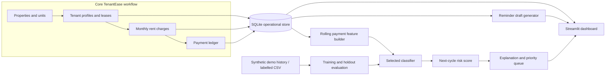

# Architecture and Data Flow

## Design choices

- **One operational store:** tenant, rent charge and payment information live in SQLite and feed both financial views and feature engineering.
- **Charge-level ledger:** one charge per tenant/month and multiple payments per charge support partial payment and settlement reconstruction.
- **No fabricated tenant history:** creating a new tenant produces current/future charges only. Missing history stays missing and is reflected in history coverage.
- **Local-first AI:** the demo model and reminder generator run locally without an external API key.
- **Replaceable training source:** upload a labelled CSV to retrain the model. The model is saved separately from the operational database.
- **Human approval:** risk estimates inform the manager's queue; reminder drafts are not sent automatically.

## Main integration point

`build_tenant_features()` reads the same `rent_charges` and `payments` tables that drive the collection ledger. A new payment therefore changes the derived tenant history and is reflected on the next Streamlit rerun. This is the key functional connection between the existing property-management workflow and the predictive feature.
