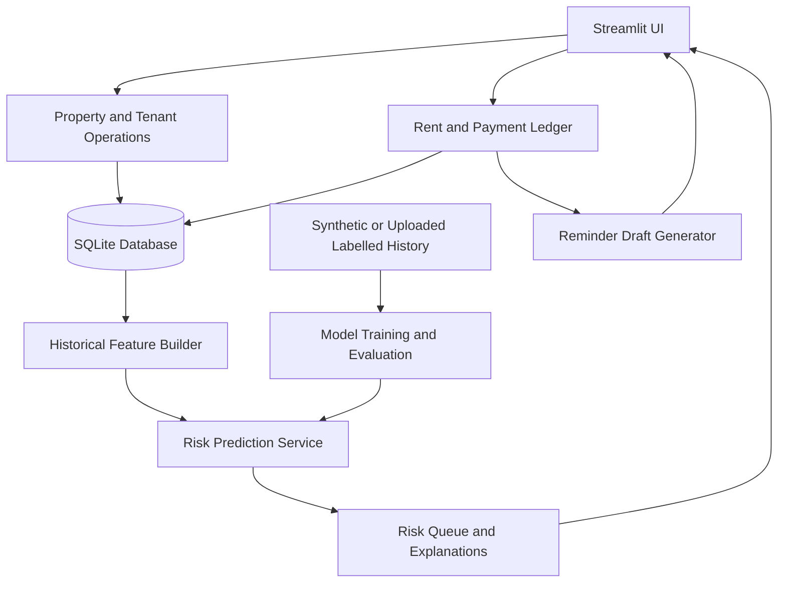

# Technical Approach Report
## TenantEase Predictive Intelligence

## 1. Architecture overview

The prototype uses a modular Python application. Streamlit is the presentation layer, SQLite stores operational records, pandas/NumPy prepare features, scikit-learn trains and evaluates classifiers, and Plotly renders dashboards.

## 2. Technology stack

| Layer | Technology | Reason |
|---|---|---|
| UI / app | Streamlit | Rapid, interactive Python prototype with forms, tables and charts |
| Storage | SQLite | Local, transactional database suitable for a self-contained assessment demo |
| Data processing | pandas, NumPy | Tabular transformation and numerical feature calculations |
| ML | scikit-learn | Transparent baseline classifiers, group-aware holdout split and evaluation metrics |
| Visualisation | Plotly | Interactive collection and risk charts |
| Model persistence | joblib | Store a locally trained custom estimator |

No paid API, external model endpoint or API key is required to run the prototype.

## 3. Data model

### `properties`
`id`, `name`, `address`, `total_units`, `created_at`.

### `tenants`
`id`, `property_id`, `unit_label`, `full_name`, `email`, `phone`, `rent_amount`, `rent_due_day`, `lease_start`, `lease_end`, `status`, `created_at`.

### `rent_charges`
`id`, `tenant_id`, `period`, `due_date`, `amount_due`, `created_at`. A unique constraint on `(tenant_id, period)` prevents duplicate monthly charges.

### `payments`
`id`, `charge_id`, `paid_on`, `amount`, `method`, `reference`, `created_at`. Multiple transactions can be linked to one rent charge so partial payments are supported.

The app derives current charge status from the outstanding balance and due date:

- Paid: outstanding balance is zero.
- Partial: some amount was received but a balance remains.
- Overdue: no amount has been received and the due date has passed.
- Pending: the due date has not passed and no amount has been received.

The prototype does not create historic unpaid charges for newly created tenants. It creates current and next-cycle charges only, avoiding invented historical behaviour. Historical payments can be populated through a future approved integration or import workflow.

## 4. Prediction target

The target is `late_next_cycle`:

- `1`: the full rent charge is settled after the configured grace period, or remains unsettled beyond the grace period.
- `0`: the charge is settled on or before the grace-period boundary.

The current prototype uses a three-day grace period in feature derivation. A production deployment should confirm the exact definition used by TenantEase and make it configurable by contract/property policy.

## 5. Feature engineering

The feature builder queries only rent charges with a due date earlier than the target cycle. It reconstructs settlement date from payment transactions by accumulating payments until the charge amount is fully covered.

Rolling features use up to the previous six observable cycles:

- `rent_amount`
- `previous_late_rate`
- `avg_delay_days`
- `late_streak`
- `payments_observed`
- `previous_missed_count`
- `recent_delay_days`
- `due_day`
- `lease_months`

Unpaid, past-grace charges are treated as late and marked as missed for the feature window. Unpaid charges that are not yet past the grace period are excluded as unresolved outcomes. This definition should be aligned with the actual finance ledger before production use.

## 6. Model strategy

Two interpretable baselines are compared:

### Random Forest Classifier
- 320 estimators
- Maximum depth: 8
- Minimum samples per leaf: 5
- Balanced subsampling of classes
- Captures non-linear relationships and feature interactions.

### Logistic Regression
- StandardScaler followed by LogisticRegression
- Class-weight balancing
- Provides a useful linear baseline.

The candidate with the higher holdout PR-AUC is selected; Brier score is used as a tie-break. The selected estimator is then refit on the complete available training dataset.

For the built-in synthetic dataset, tenant groups are kept separate between training and holdout sets using `GroupShuffleSplit`. If an uploaded CSV contains a `tenant_group` column with enough unique groups, the same group-aware method is used. Otherwise, a stratified random split is used and the report should disclose that the data may not be independent by tenant.

## 7. Evaluation

The app reports:

- Accuracy
- Precision
- Recall
- PR-AUC / average precision
- ROC-AUC
- Brier score

PR-AUC is important when late payments are the minority class. Recall helps measure how many late cycles are identified, while precision indicates how much review effort may be spent on alerts that do not become late. Brier score gives a view of probability calibration. A production pilot should add threshold analysis, confidence intervals, temporal backtesting, calibration curves and subgroup error analysis.

The built-in model metrics are only a demonstration of the training/evaluation pipeline on synthetic data. They are not evidence of real-world TenantEase model quality.

## 8. Prediction and explanation flow

1. Select active tenants with an upcoming rent charge.
2. Retrieve all prior rent charges and payment transactions before the target due date.
3. Reconstruct settlement outcomes and calculate rolling features.
4. Obtain `predict_proba` for the late class.
5. Assign demonstration bands: Low below 35%, Medium 35% to below 65%, High 65% or above.
6. Display history coverage and heuristic reasons/actions.
7. Allow the property manager to review the ledger and generate a reminder draft.

The interface displays a limited-history note when fewer than three completed/observable cycles are available. Production thresholds should be selected using business costs and historical validation, not copied from the demo.

## 9. Prompt engineering / LLM architecture

The proof of concept intentionally uses a deterministic reminder-drafting module instead of an external LLM. It assembles a template from verified ledger fields: tenant name, property, unit, period, due date and outstanding balance. This avoids hallucinated amounts, false claims and dependence on an external API key.

A production LLM extension could be added for language personalisation, but it should receive only verified charge facts and a constrained instruction such as:

- Draft a concise, respectful payment reminder.
- Use only the supplied verified fields.
- Do not mention or infer financial hardship, intent, character or risk score.
- Do not threaten penalties or legal action unless exact approved policy text is provided.
- Return a draft for manager approval; never send it.

The deterministic draft is the safe working fallback if an LLM is unavailable.

## 10. Execution plan for a production pilot

1. **Discovery:** confirm TenantEase's actual schema, charge lifecycle, grace-period policy, user roles and existing reminder integrations.
2. **Data audit:** obtain permissioned, de-identified historical charge/payment records. Check missing records, reversals, partial payments, write-offs and charge amendments.
3. **Label design:** have product/finance stakeholders approve what counts as late and choose the prediction horizon.
4. **Backtesting:** split by time and tenant to simulate prospective prediction; compare against simple rules and current process.
5. **Calibration:** calibrate predicted probabilities and choose thresholds based on follow-up capacity and false-alert costs.
6. **Shadow deployment:** run predictions without changing staff workflows; compare estimates with actual outcomes.
7. **Human-in-the-loop pilot:** expose explanations, allow corrections and log manager actions.
8. **Production integration:** use approved TenantEase APIs, authentication, roles, tenant isolation, secure data stores and observability.
9. **Monitoring:** track drift, missingness, calibration, precision/recall, alert volume, manager overrides and outcome changes by property.

## 11. Security and operational limitations

This assessment build is a local, single-workspace prototype. It does not implement user authentication, RBAC, multi-tenant cloud isolation, encryption-at-rest setup, payment processing, automatic communications, backups or production monitoring. It should only use synthetic or appropriately authorised test data.

Predictions must remain advisory. The application must not automatically deny accommodation, increase rent, apply penalties or trigger adverse treatment. Provide human review, correction and audit mechanisms before any live use.
